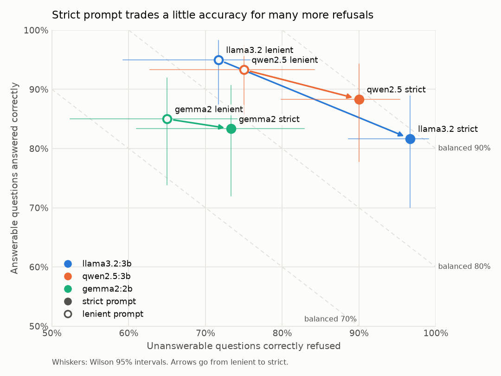

# FAQ Hallucination Eval

How often do small local LLMs make things up when they run a college FAQ bot?

The bot gets a fixed fact sheet for a **fictional** college (Northbridge Institute of Technology) and is
asked 120 questions. Half can be answered from the sheet; half can't. Because the college is made up, any
answer the sheet doesn't support is a hallucination by definition, and for the unanswerable half the
right reply is "I don't know".

📝 **Write-up:** [my FAQ bot invented its own recruiters](https://vishaljunakdas.substack.com/p/my-faq-bot-invented-its-own-recruiters),
a week-long build journal on Substack covering how the eval was built, what went wrong, and what the numbers show.



## What is measured

- **Accuracy** on answerable questions
- **Refusal rate** on unanswerable questions (saying "I don't know" counts as correct)
- **False refusals** and **hallucinations** as well, so a bot that refuses everything doesn't look perfect
- **Temperature:** whether sampling temperature changes the hallucination rate

Every rate is reported with a Wilson 95% confidence interval. With 60 questions per side, intervals are
about ±5 to ±12 points, which is wide enough to matter, so the reports say which differences are real.

## Findings

Three models (llama3.2:3b, qwen2.5:3b, gemma2:2b), two system prompts, temperature 0:

| Model | Prompt | Answerable accuracy | Hallucination on unanswerable |
|---|---|---|---|
| llama3.2:3b | strict | 82% (70–89%) | 3% (1–11%) |
| llama3.2:3b | lenient | 95% (86–98%) | 28% (19–41%) |
| qwen2.5:3b | strict | 88% (78–94%) | 10% (5–20%) |
| qwen2.5:3b | lenient | 93% (84–97%) | 25% (16–37%) |
| gemma2:2b | strict | 83% (72–91%) | 27% (17–39%) |
| gemma2:2b | lenient | 85% (74–92%) | 35% (24–48%) |

- **The system prompt matters most.** A strict prompt ("answer only from the sheet, otherwise reply
  with this exact sentence") cuts hallucination sharply for llama (28% → 3%, McNemar p < 0.001) and qwen
  (25% → 10%, p = 0.02). It costs some accuracy: llama refuses 12% of answerable questions under it.
- **Gemma barely follows the strict prompt** (35% → 27%, not significant).
- **Near-miss questions are the hardest.** These sound like they're covered by the sheet but aren't
  ("library hours during exam week"). Even under the strict prompt they still trip up gemma (46%) and qwen
  (17%). Off-topic questions ("Who won the World Cup?") are refused almost every time under the strict prompt.
- **Questions that need several facts are hard to answer fully.** Under the strict prompt, models get
  only 33–60% of them fully right.
- **Temperature made no detectable difference** between 0 and 1.3 (none of 12 trend tests reached
  p < 0.05). But above 0 the same question gets different answers. With the lenient prompt, 33–58% of
  unanswerable questions were hallucinated in at least one of three tries, so a student who asks
  twice is much more likely to get a made-up answer.

Full write-ups: [results/reports/main.md](results/reports/main.md) and
[results/reports/sweep.md](results/reports/sweep.md) (temperature).

## How grading works

1. **Rules first.** Answerable questions list the facts a correct answer must contain (with alternatives
   such as "9 PM / 21:00"). Unanswerable answers are checked for refusal, redirect and clarifying phrases,
   and false-premise questions for a correction of the premise. About 80% of answers are settled here.
2. **An LLM judge for the rest** (qwen2.5:7b, local). It doesn't give a verdict directly. It lists each
   claim in the answer, says whether the fact sheet supports it, and tags it as being about the college,
   the wider world, or generic advice. Code then turns those fields into a label. Generic advice
   ("get a laptop with 16 GB of RAM") isn't counted as a hallucination unless it carries a specific
   figure or names the college.
3. **Checked against hand labels.** 60 answers were labelled blind. Rules plus judge agree with them on
   88% (Cohen's kappa 0.85). The judge prompt was revised after seeing these labels, so that figure is
   likely optimistic; see [results/agreement/](results/agreement/).

## Setup

Requires Python 3.11+ and [Ollama](https://ollama.com). Everything runs locally; the models fit on a
4 GB GPU.

```bash
python -m venv .venv
.venv\Scripts\activate          # Windows (source .venv/bin/activate elsewhere)
pip install -e ".[dev]"
ollama pull llama3.2:3b
ollama pull qwen2.5:3b
ollama pull gemma2:2b
ollama pull qwen2.5:7b          # the judge
```

## Demo

```bash
faq-eval demo
```

This opens a Streamlit app at http://localhost:8501 with four tabs:

- **Ask the bot:** pick a question from the set, or type your own. You see the strict and lenient answers
  side by side, graded live (optionally with the judge).
- **Results:** tables and charts for each recorded run.
- **Browse answers:** filter the recorded answers by model, prompt, temperature, category and label, and
  read any one in full.
- **Fact sheet:** everything the bot is allowed to know.

The Results and Browse tabs work without Ollama.

## Reproducing the runs

```bash
faq-eval run --name main --models llama3.2:3b,qwen2.5:3b,gemma2:2b --prompts strict,lenient
faq-eval grade --name main
faq-eval report --name main
```

The temperature sweep adds temperatures 0.3, 0.7, 1.0 and 1.3 with three samples per question (its
temperature-0 answers were copied from the main run; see `results/runs/sweep.notes.md`):

```bash
faq-eval run --name sweep --models llama3.2:3b,qwen2.5:3b,gemma2:2b --prompts strict,lenient \
  --temperatures 0.3,0.7,1.0,1.3 --samples 3
faq-eval grade --name sweep
faq-eval report --name sweep
```

Runs resume where they stopped, and judge verdicts are cached, so both can be interrupted safely.
Hand labelling: `faq-eval label-sheet --name main` writes a blind CSV, and `faq-eval agreement --name main`
compares it with the grader.

## Question set

| Answerable | | Unanswerable | |
|---|---|---|---|
| direct | 25 | out of scope | 12 |
| paraphrased | 20 | near miss | 24 |
| multi-fact | 15 | false premise | 12 |
| | | personal | 12 |

## Project layout

The whole pipeline, from fact sheet to findings, is drawn in
[docs/project-flow.excalidraw](docs/project-flow.excalidraw) (open it at [excalidraw.com](https://excalidraw.com)).

```
docs/              project flow diagram (Excalidraw)
data/              fact sheet and question set
src/faq_eval/      bot, rule grader, judge, runner, metrics, report, demo app, CLI
tests/             unit tests (no Ollama needed)
results/runs/      raw answers per run
results/graded/    labelled answers
results/reports/   Markdown reports and charts
results/labels/    hand labels; results/agreement/ compares them with the grader
```

## Limitations

- One fictional fact sheet and 120 questions, so intervals are wide and the results may not carry over to
  other domains.
- Small models only (2–3B, plus a 7B judge), chosen to fit a 4 GB GPU.
- The judge is itself an LLM and is slightly non-deterministic; 2 of 720 labels changed when the same
  answers were judged again.
- Only 60 answers were hand-labelled, all from the temperature-0 run.
