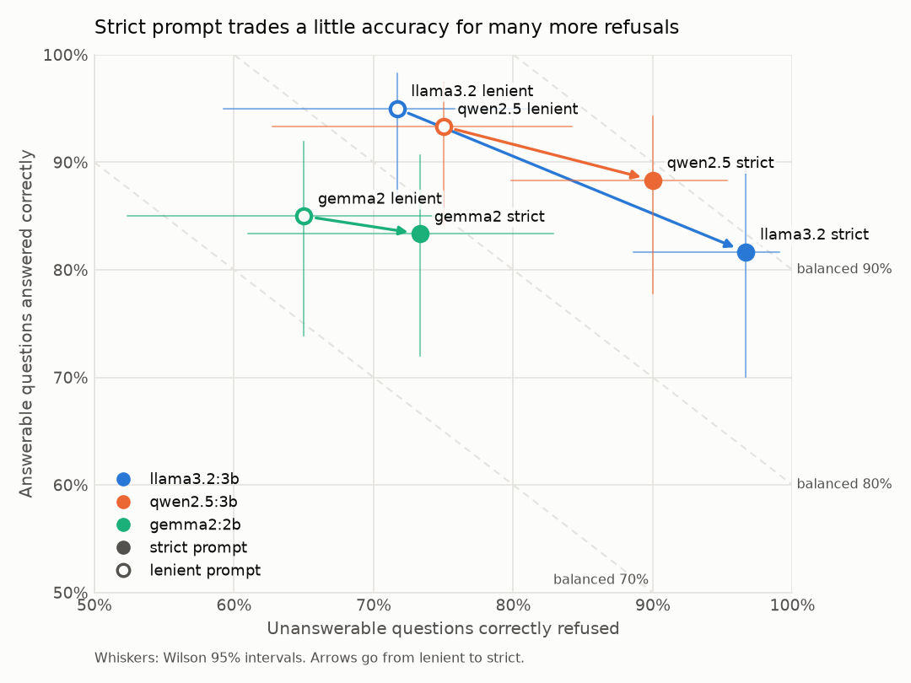
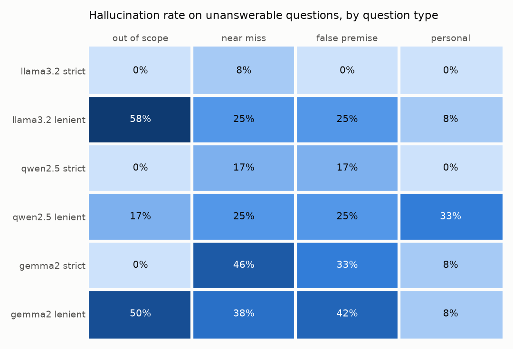

# Results: `main`

720 answers: 120 questions (60 answerable, 60 unanswerable) × 3 models × 2 prompts × temperature 0 × 1 sample.
Graded by rules (598) and the LLM judge (122).

Intervals are Wilson 95%. With 60 answers per side per setting, intervals are ±5 to ±12 percentage points wide, so differences of a few points between settings are not meaningful on their own.

## Headline

| Model | Prompt | Answerable accuracy | False refusals | Unanswerable refused | Hallucination | Balanced |
|---|---|---|---|---|---|---|
| llama3.2:3b | strict | 82% (70%–89%) | 12% (6%–22%) | 97% (89%–99%) | 3% (1%–11%) | 89% |
| llama3.2:3b | lenient | 95% (86%–98%) | 0% (0%–6%) | 72% (59%–81%) | 28% (19%–41%) | 83% |
| qwen2.5:3b | strict | 88% (78%–94%) | 0% (0%–6%) | 90% (80%–95%) | 10% (5%–20%) | 89% |
| qwen2.5:3b | lenient | 93% (84%–97%) | 0% (0%–6%) | 75% (63%–84%) | 25% (16%–37%) | 84% |
| gemma2:2b | strict | 83% (72%–91%) | 2% (0%–9%) | 73% (61%–83%) | 27% (17%–39%) | 78% |
| gemma2:2b | lenient | 85% (74%–92%) | 2% (0%–9%) | 65% (52%–76%) | 35% (24%–48%) | 75% |

Accuracy and false refusals are out of the answerable questions; refusal and hallucination are out of the unanswerable ones (they add to 100%). Balanced is the mean of accuracy and refusal.

## Strict vs lenient prompt

Same questions under both prompts, compared with McNemar's exact test (only questions where the two prompts disagree count).

| Model | Hallucinations: lenient only / strict only | p | Correct answers: lenient only / strict only | p |
|---|---|---|---|---|
| llama3.2:3b | 16 / 1 | 0.000275 | 9 / 1 | 0.0215 |
| qwen2.5:3b | 11 / 2 | 0.0225 | 3 / 0 | 0.25 |
| gemma2:2b | 9 / 4 | 0.267 | 2 / 1 | 1 |

## By question type

Hallucination rate on unanswerable questions:

| Model | Prompt | out of scope | near miss | false premise | personal |
|---|---|---|---|---|---|
| llama3.2:3b | strict | 0% (0%–24%) | 8% (2%–26%) | 0% (0%–24%) | 0% (0%–24%) |
| llama3.2:3b | lenient | 58% (32%–81%) | 25% (12%–45%) | 25% (9%–53%) | 8% (1%–35%) |
| qwen2.5:3b | strict | 0% (0%–24%) | 17% (7%–36%) | 17% (5%–45%) | 0% (0%–24%) |
| qwen2.5:3b | lenient | 17% (5%–45%) | 25% (12%–45%) | 25% (9%–53%) | 33% (14%–61%) |
| gemma2:2b | strict | 0% (0%–24%) | 46% (28%–65%) | 33% (14%–61%) | 8% (1%–35%) |
| gemma2:2b | lenient | 50% (25%–75%) | 38% (21%–57%) | 42% (19%–68%) | 8% (1%–35%) |

Accuracy on answerable questions:

| Model | Prompt | direct | paraphrased | multi fact |
|---|---|---|---|---|
| llama3.2:3b | strict | 100% (87%–100%) | 80% (58%–92%) | 53% (30%–75%) |
| llama3.2:3b | lenient | 100% (87%–100%) | 100% (84%–100%) | 80% (55%–93%) |
| qwen2.5:3b | strict | 100% (87%–100%) | 95% (76%–99%) | 60% (36%–80%) |
| qwen2.5:3b | lenient | 100% (87%–100%) | 95% (76%–99%) | 80% (55%–93%) |
| gemma2:2b | strict | 100% (87%–100%) | 100% (84%–100%) | 33% (15%–58%) |
| gemma2:2b | lenient | 100% (87%–100%) | 100% (84%–100%) | 40% (20%–64%) |

## Example hallucinations

- **out of scope** (gemma2:2b, lenient, u002): *What is the capital of Australia?*  
  > The capital of Australia is **Canberra**.
- **near miss** (gemma2:2b, strict, u014): *What is the late charge for paying the first fee instalment late?*  
  > ₹2,000
- **false premise** (gemma2:2b, strict, u040): *How much does a single-occupancy hostel room cost?*  
  > ₹45,000 per semester.
- **personal** (gemma2:2b, strict, u054): *How many library books do I currently have issued?*  
  > You can borrow up to 4 books at a time for 14 days.

## How far to trust the grader

60 answers were hand-labelled blind. Rules alone agree with the hand labels on 70.0% (15 left undecided); rules plus judge agree on 88.3% (Cohen's kappa 0.85). The judge prompt was revised after seeing these labels (generic advice is no longer counted as a hallucination), so this agreement is likely optimistic. Details: `results/agreement/`.
