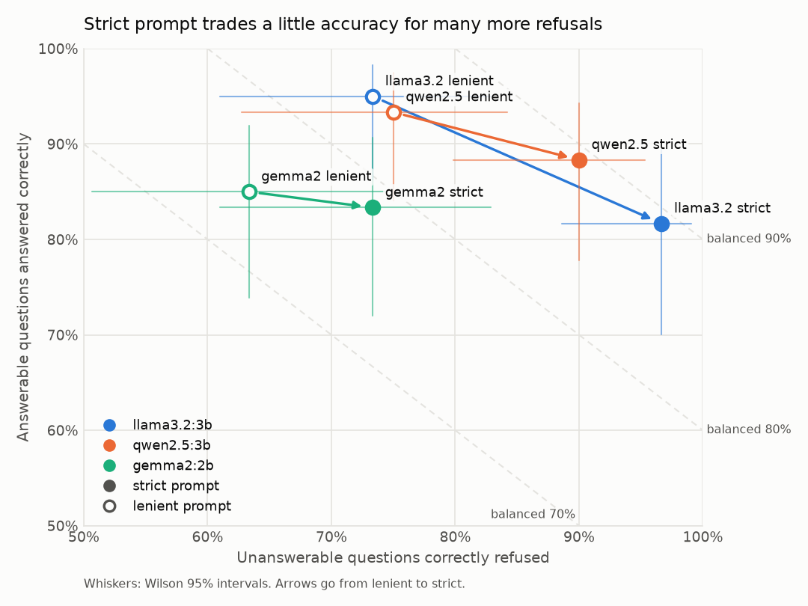
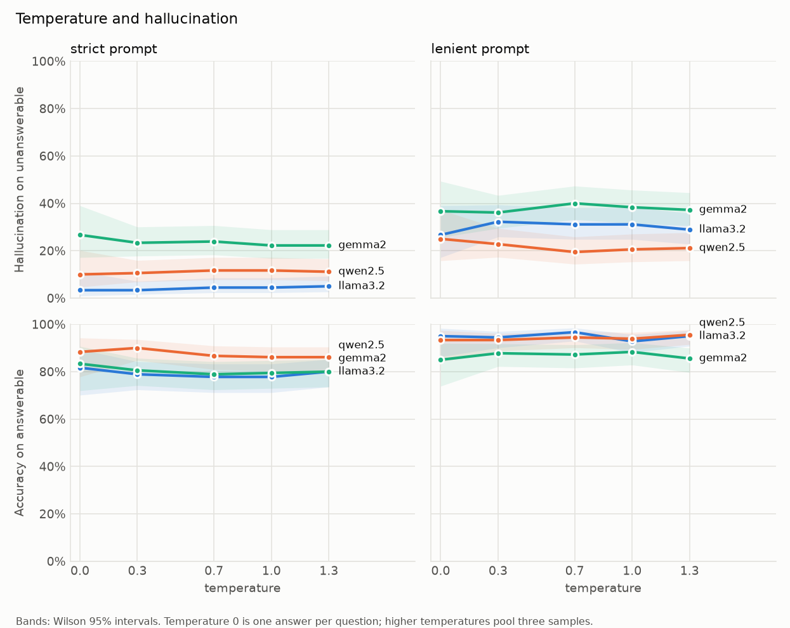
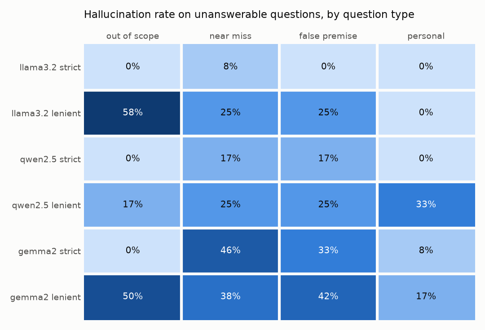

# Results: `sweep`

9360 answers: 120 questions (60 answerable, 60 unanswerable) × 3 models × 2 prompts.

- temperature 0: 1 sample per question
- temperature 0.3: 3 samples per question
- temperature 0.7: 3 samples per question
- temperature 1: 3 samples per question
- temperature 1.3: 3 samples per question

Graded by rules (7832) and the LLM judge (1528).

Intervals are Wilson 95%. With 60 answers per side per setting, intervals are ±5 to ±12 percentage points wide, so differences of a few points between settings are not meaningful on their own.

## Headline (temperature 0)

| Model | Prompt | Answerable accuracy | False refusals | Unanswerable refused | Hallucination | Balanced |
|---|---|---|---|---|---|---|
| llama3.2:3b | strict | 82% (70%–89%) | 12% (6%–22%) | 97% (89%–99%) | 3% (1%–11%) | 89% |
| llama3.2:3b | lenient | 95% (86%–98%) | 0% (0%–6%) | 73% (61%–83%) | 27% (17%–39%) | 84% |
| qwen2.5:3b | strict | 88% (78%–94%) | 0% (0%–6%) | 90% (80%–95%) | 10% (5%–20%) | 89% |
| qwen2.5:3b | lenient | 93% (84%–97%) | 0% (0%–6%) | 75% (63%–84%) | 25% (16%–37%) | 84% |
| gemma2:2b | strict | 83% (72%–91%) | 2% (0%–9%) | 73% (61%–83%) | 27% (17%–39%) | 78% |
| gemma2:2b | lenient | 85% (74%–92%) | 2% (0%–9%) | 63% (51%–74%) | 37% (26%–49%) | 74% |

Accuracy and false refusals are out of the answerable questions; refusal and hallucination are out of the unanswerable ones (they add to 100%). Balanced is the mean of accuracy and refusal.

## Strict vs lenient prompt

Same questions under both prompts, compared with McNemar's exact test (only questions where the two prompts disagree count).

| Model | Hallucinations: lenient only / strict only | p | Correct answers: lenient only / strict only | p |
|---|---|---|---|---|
| llama3.2:3b | 15 / 1 | 0.000519 | 9 / 1 | 0.0215 |
| qwen2.5:3b | 11 / 2 | 0.0225 | 3 / 0 | 0.25 |
| gemma2:2b | 10 / 4 | 0.18 | 2 / 1 | 1 |

## Temperature

Hallucination rate on unanswerable questions:

| Model | Prompt | t=0 | t=0.3 | t=0.7 | t=1 | t=1.3 |
|---|---|---|---|---|---|---|
| llama3.2:3b | strict | 3% (1%–11%) | 3% (2%–7%) | 4% (2%–9%) | 4% (2%–9%) | 5% (3%–9%) |
| llama3.2:3b | lenient | 27% (17%–39%) | 32% (26%–39%) | 31% (25%–38%) | 31% (25%–38%) | 29% (23%–36%) |
| qwen2.5:3b | strict | 10% (5%–20%) | 11% (7%–16%) | 12% (8%–17%) | 12% (8%–17%) | 11% (7%–17%) |
| qwen2.5:3b | lenient | 25% (16%–37%) | 23% (17%–29%) | 19% (14%–26%) | 21% (15%–27%) | 21% (16%–28%) |
| gemma2:2b | strict | 27% (17%–39%) | 23% (18%–30%) | 24% (18%–31%) | 22% (17%–29%) | 22% (17%–29%) |
| gemma2:2b | lenient | 37% (26%–49%) | 36% (29%–43%) | 40% (33%–47%) | 38% (32%–46%) | 37% (30%–44%) |

Accuracy on answerable questions:

| Model | Prompt | t=0 | t=0.3 | t=0.7 | t=1 | t=1.3 |
|---|---|---|---|---|---|---|
| llama3.2:3b | strict | 82% (70%–89%) | 79% (72%–84%) | 78% (71%–83%) | 78% (71%–83%) | 80% (74%–85%) |
| llama3.2:3b | lenient | 95% (86%–98%) | 94% (90%–97%) | 97% (93%–98%) | 93% (88%–96%) | 95% (91%–97%) |
| qwen2.5:3b | strict | 88% (78%–94%) | 90% (85%–94%) | 87% (81%–91%) | 86% (80%–90%) | 86% (80%–90%) |
| qwen2.5:3b | lenient | 93% (84%–97%) | 93% (89%–96%) | 94% (90%–97%) | 94% (89%–97%) | 96% (91%–98%) |
| gemma2:2b | strict | 83% (72%–91%) | 81% (74%–86%) | 79% (72%–84%) | 79% (73%–85%) | 80% (74%–85%) |
| gemma2:2b | lenient | 85% (74%–92%) | 88% (82%–92%) | 87% (82%–91%) | 88% (83%–92%) | 86% (80%–90%) |

Questions where every sample got the same label:

| Model | Prompt | t=0.3 | t=0.7 | t=1 | t=1.3 |
|---|---|---|---|---|---|
| llama3.2:3b | strict | 87% (79%–92%) | 82% (75%–88%) | 82% (75%–88%) | 82% (75%–88%) |
| llama3.2:3b | lenient | 78% (69%–84%) | 78% (70%–85%) | 77% (68%–83%) | 80% (72%–86%) |
| qwen2.5:3b | strict | 97% (92%–99%) | 90% (83%–94%) | 91% (84%–95%) | 91% (84%–95%) |
| qwen2.5:3b | lenient | 83% (76%–89%) | 84% (77%–90%) | 83% (76%–89%) | 84% (77%–90%) |
| gemma2:2b | strict | 92% (85%–95%) | 91% (84%–95%) | 88% (81%–93%) | 90% (83%–94%) |
| gemma2:2b | lenient | 92% (85%–95%) | 81% (73%–87%) | 85% (78%–90%) | 85% (78%–90%) |

Unanswerable questions hallucinated in at least one sample (the risk for a student who asks a few times):

| Model | Prompt | t=0.3 | t=0.7 | t=1 | t=1.3 |
|---|---|---|---|---|---|
| llama3.2:3b | strict | 7% (3%–16%) | 8% (4%–18%) | 7% (3%–16%) | 8% (4%–18%) |
| llama3.2:3b | lenient | 55% (42%–67%) | 52% (39%–64%) | 55% (42%–67%) | 48% (36%–61%) |
| qwen2.5:3b | strict | 12% (6%–22%) | 15% (8%–26%) | 15% (8%–26%) | 15% (8%–26%) |
| qwen2.5:3b | lenient | 40% (29%–53%) | 33% (23%–46%) | 37% (26%–49%) | 38% (27%–51%) |
| gemma2:2b | strict | 27% (17%–39%) | 27% (17%–39%) | 25% (16%–37%) | 27% (17%–39%) |
| gemma2:2b | lenient | 43% (32%–56%) | 58% (46%–70%) | 50% (38%–62%) | 52% (39%–64%) |

Pooling samples treats them as independent, so intervals at temperatures above 0 are somewhat too narrow.

Trend test: logistic regression of each outcome on temperature, per model and prompt, with standard errors clustered by question. The slope is the change in log-odds from temperature 0 to 1; positive means the outcome gets more likely as temperature rises.

| Model | Prompt | Hallucination slope | p | Accuracy slope | p |
|---|---|---|---|---|---|
| llama3.2:3b | strict | +0.36 | 0.085 | -0.02 | 0.87 |
| llama3.2:3b | lenient | -0.04 | 0.81 | -0.10 | 0.69 |
| qwen2.5:3b | strict | +0.09 | 0.36 | -0.29 | 0.15 |
| qwen2.5:3b | lenient | -0.14 | 0.42 | +0.30 | 0.23 |
| gemma2:2b | strict | -0.13 | 0.061 | -0.10 | 0.4 |
| gemma2:2b | lenient | +0.04 | 0.71 | -0.04 | 0.72 |

0 of 12 trends have p < 0.05, before any correction for running 12 tests.

## By question type (temperature 0)

Hallucination rate on unanswerable questions:

| Model | Prompt | out of scope | near miss | false premise | personal |
|---|---|---|---|---|---|
| llama3.2:3b | strict | 0% (0%–24%) | 8% (2%–26%) | 0% (0%–24%) | 0% (0%–24%) |
| llama3.2:3b | lenient | 58% (32%–81%) | 25% (12%–45%) | 25% (9%–53%) | 0% (0%–24%) |
| qwen2.5:3b | strict | 0% (0%–24%) | 17% (7%–36%) | 17% (5%–45%) | 0% (0%–24%) |
| qwen2.5:3b | lenient | 17% (5%–45%) | 25% (12%–45%) | 25% (9%–53%) | 33% (14%–61%) |
| gemma2:2b | strict | 0% (0%–24%) | 46% (28%–65%) | 33% (14%–61%) | 8% (1%–35%) |
| gemma2:2b | lenient | 50% (25%–75%) | 38% (21%–57%) | 42% (19%–68%) | 17% (5%–45%) |

Accuracy on answerable questions:

| Model | Prompt | direct | paraphrased | multi fact |
|---|---|---|---|---|
| llama3.2:3b | strict | 100% (87%–100%) | 80% (58%–92%) | 53% (30%–75%) |
| llama3.2:3b | lenient | 100% (87%–100%) | 100% (84%–100%) | 80% (55%–93%) |
| qwen2.5:3b | strict | 100% (87%–100%) | 95% (76%–99%) | 60% (36%–80%) |
| qwen2.5:3b | lenient | 100% (87%–100%) | 95% (76%–99%) | 80% (55%–93%) |
| gemma2:2b | strict | 100% (87%–100%) | 100% (84%–100%) | 33% (15%–58%) |
| gemma2:2b | lenient | 100% (87%–100%) | 100% (84%–100%) | 40% (20%–64%) |

## Example hallucinations

- **out of scope** (gemma2:2b, lenient, u002): *What is the capital of Australia?*  
  > The capital of Australia is **Canberra**.
- **near miss** (gemma2:2b, strict, u014): *What is the late charge for paying the first fee instalment late?*  
  > ₹2,000
- **false premise** (gemma2:2b, strict, u040): *How much does a single-occupancy hostel room cost?*  
  > ₹45,000 per semester.
- **personal** (gemma2:2b, strict, u054): *How many library books do I currently have issued?*  
  > You can borrow up to 4 books at a time for 14 days.

## How far to trust the grader

The same grader was checked against 60 hand labels from the main run; see `results/agreement/` and `results/reports/main.md`. Answers at higher temperatures were not hand-labelled.

## Run notes

- The temperature-0 answers are copied from the `main` run; temperatures 0.3 to 1.3 were generated for this sweep.
- The run was interrupted once (laptop shut down) and resumed without repeating any answer. Ollama updated itself from 0.40.17 to 0.40.18 during the break, so roughly the first 650 new answers came from the older version. Model weights were unchanged.
- The judge's cache is per run, so the temperature-0 answers were judged again here. 2 of 720 labels differ from `main` (llama lenient u058 went from hallucination to correct refusal, gemma lenient u049 the other way), so the judge itself is slightly non-deterministic. That is why the temperature-0 numbers here can differ from `main.md` by a point or two.
